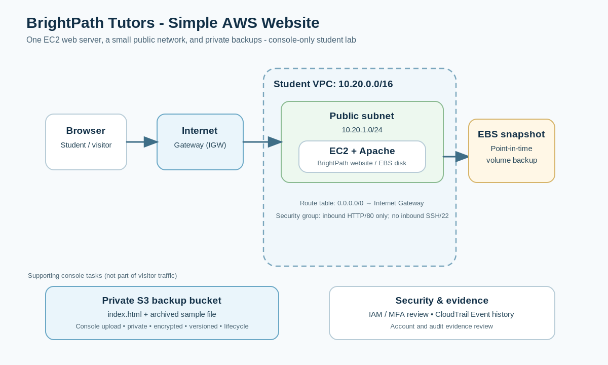

# BrightPath Tutors
## BaseStack Academy Cohort 2 - Simple AWS Capstone

**Project type:** Beginner • **Build method:** AWS Management Console only • **Estimated lab size:** One website, one server, one backup bucket

## 1. What you are building

BrightPath Tutors is a small tutoring business that needs a simple public website describing its services and contact details. You will launch the website on one Amazon EC2 virtual server, set up the network so visitors can reach it, and make a private backup copy in Amazon S3.

You will also create an EBS snapshot, check an event in CloudTrail, and answer short questions about security, scaling, storage, and databases. You are **not** expected to build a complex production platform.

### What success looks like

- A browser can open your BrightPath Tutors website using the EC2 public IPv4 address.
- The server is in your own VPC and public subnet.
- The security group allows web traffic on port 80 but has no inbound SSH rule.
- A private S3 bucket holds a copy of `index.html`, has encryption and versioning enabled, and has one lifecycle rule.
- An EBS snapshot exists and you can find one project event in CloudTrail Event history.
- You can explain when a database, load balancer, Auto Scaling, EFS, or NAT Gateway would be useful.
- You clean up the resources after collecting evidence.

## 2. The architecture

The visitor's browser reaches the website through the Internet Gateway and the public subnet. EC2 runs the web server. EBS provides the server's disk, and an EBS snapshot is a point-in-time backup of that volume. S3 stores a separate private copy of the website file. CloudTrail records supported AWS account activity for review.

## 3. Which course weeks does this use?

| Week | What you practise in this capstone |
|---|---|
| 1 - Cloud Foundations | Select the approved Region, distinguish Regions from Availability Zones, and explain shared responsibility. |
| 2 - IAM & Security | Use your assigned identity safely, review MFA and least privilege, and find a project event in CloudTrail. AWS Organizations is a short concept question; do not change a shared organisation. |
| 3 - Networking | Build a VPC, public subnet, Internet Gateway, route table, and security group. Inspect the Network ACL and explain NAT Gateway. |
| 4 - Compute | Choose an AMI and small EC2 instance type, check pricing, and use the launch wizard's User data field to start the website automatically. Discuss load balancers and Auto Scaling. |
| 5 - Storage | Back up the website file to private S3, enable encryption/versioning, create a lifecycle rule, and make an EBS snapshot. Explain when EFS is useful. |
| 6 - Databases | Complete a short selection worksheet for RDS/Aurora, DynamoDB, and ElastiCache. No database needs to be deployed for this informational website. |

**Important:** The live build stays small on purpose. Do not deploy every service mentioned in the course. NAT Gateway, Load Balancer, Auto Scaling Group, EFS, RDS/Aurora, DynamoDB, and ElastiCache are not required resources for this capstone.

## 4. Before you start

1. Use the AWS account or sandbox and Region approved by your instructor.
2. Check the price and allowed instance types shown for that Region before launching EC2. Prices and free-tier eligibility depend on the account, Region, and current AWS terms.
3. Keep the website synthetic. Do not publish real student details, passwords, keys, phone numbers, or private data.
4. **Console-only rule:** Do all work in AWS Management Console and a browser. Do not use AWS CLI, CloudShell, a terminal, SSH, or Session Manager. The included startup script is pasted into the EC2 console; EC2 runs it automatically on first boot.
5. If your classroom role does not allow a security/account action, do not work around it. Take a screenshot of the permission error if appropriate and tell your instructor.

## 5. Build the project

### Phase A - Account and security check

1. Sign in with the identity supplied by your instructor. Do not create new IAM users or change organisation-wide settings in a shared classroom account.
2. If the lab permits it, open IAM and inspect the role/policy information your instructor has provided. Do not edit the policy or attach extra permissions. This is how IAM roles and policies control what an identity can do. Some managed roles will not be visible to students.
3. If you control your own training account, verify that MFA is enabled for the identity you use. If you are in a managed lab, follow the instructor's MFA process instead.
4. Note the Region at the top of the console. Record it in your final report.
5. Keep a note of the two security rules for this project: **only HTTP needs public inbound access; the S3 backup stays private**.

### Phase B - Create the network

Use the VPC console. In simple terms: a VPC is your network, a subnet is a smaller part of that network, a route table tells traffic where to go, an Internet Gateway connects the VPC to the internet, and a security group acts like a firewall for the instance. Names below are suggestions; include your initials if your instructor asks.

1. **Create the VPC.** Open VPC > Your VPCs > Create VPC. Choose **VPC only**. Name it `brightpath-vpc` and set IPv4 CIDR to `10.20.0.0/16`. Leave tenancy at the default. Create it.
2. **Create one subnet.** Open Subnets > Create subnet. Select `brightpath-vpc`, choose one Availability Zone, name the subnet `brightpath-public-subnet`, and set IPv4 CIDR to `10.20.1.0/24`.
3. **Assign public IPs.** Select the new subnet, open its subnet settings/actions, and enable auto-assign public IPv4 addresses.
4. **Create an Internet Gateway.** Open Internet gateways > Create internet gateway, name it `brightpath-igw`, then attach it to `brightpath-vpc`.
5. **Create and connect a route table.** Open Route tables > Create route table, name it `brightpath-public-rt`, and select `brightpath-vpc`. In Routes, add destination `0.0.0.0/0` with target `brightpath-igw`. In Subnet associations, associate `brightpath-public-subnet`.
6. **Create a web security group.** Open Security groups > Create security group. Name it `brightpath-web-sg` and select `brightpath-vpc`. Add one inbound rule: HTTP, TCP, port 80, source `0.0.0.0/0`. Do not add SSH/22. Keep the default outbound rule unless the instructor specifies otherwise.
7. **Inspect, do not redesign, the Network ACL.** Open Network ACLs and identify which ACL is associated with your subnet. For this beginner project, leave the default rules unchanged.

**Check before moving on:** Your subnet has a route to the Internet Gateway. The security group allows HTTP but not SSH. Do not create a NAT Gateway: this design has one public web server and no private server that needs outbound-only internet access.

### Phase C - Create the private S3 backup bucket

1. Open S3 > Create bucket. Choose a globally unique lowercase name, for example `brightpath-backup-ab12-4821`. Do not use personal information in the name.
2. Keep **Block Public Access** enabled. Keep the default bucket-owner-enforced object ownership. Leave default encryption enabled (normally SSE-S3 unless the instructor specifies otherwise). Create the bucket.
3. Open the bucket's Properties and enable Versioning.
4. On the Objects tab, upload `starter-materials/index.html` using the Upload button.
5. Upload `sample-data/old-brochure.txt` under a folder/prefix named `archive/` (create the `archive` folder in the S3 console if needed).
6. Create a lifecycle rule in Management. Name it `archive-to-infrequent-access`, limit its scope to prefix `archive/`, and transition current versions to **S3 Standard-IA after 30 days**. This rule is for practice; you will not wait 30 days to test it.
7. To demonstrate versioning, change one visible sentence in your local copy of `index.html`, save it with the same filename, then upload it to the same S3 bucket and key. Confirm that the object has two versions. Do not make the bucket public to test this.

**Check before moving on:** The bucket remains private, versioning is enabled, two versions of `index.html` are visible, and the lifecycle rule is saved.

### Phase D - Launch the website on EC2

1. Open EC2 > Instances > Launch instances. Name the instance `brightpath-web-01`.
2. Choose an **Amazon Linux 2023** AMI.
3. Choose the smallest instance type permitted by your course account and suitable for a short lab. Check its price in the selected Region; do not assume every account has the same free-tier eligibility.
4. For key pair, choose the option to proceed without a key pair if your class environment permits it. You will not log in to the instance. Do not enable SSH.
5. Under Network settings, choose `brightpath-vpc`, `brightpath-public-subnet`, enable auto-assign public IPv4, and select the existing `brightpath-web-sg` security group.
6. Under storage, keep the small default root EBS volume (8 GiB is enough for this exercise). Select encryption if the wizard offers the option or confirm your account's default EBS encryption setting.
7. Expand Advanced details. In **User data**, open `starter-materials/ec2-user-data.txt`, copy the entire file, and paste it into the field. Do not run the text yourself. It installs the web server and creates the sample page during first boot.
8. Launch the instance. Wait until the instance is running, then copy its Public IPv4 address from the instance details.
9. Open a new browser tab and visit `http://YOUR-PUBLIC-IP` (replace the example with the actual address). Allow a few minutes for the first-boot setup to finish.

**Check before moving on:** The browser displays the BrightPath Tutors title, three service areas, email, and opening hours. If it does not load, use the troubleshooting table below; do not open SSH or a terminal.

### Phase E - Backup and audit evidence

1. In EC2, select the instance and open the Storage tab to identify its root EBS volume ID.
2. Open EC2 > Elastic Block Store > Snapshots > Create snapshot. Choose **Volume** as the resource type, select the root volume, enter description `brightpath-root-backup`, and create the snapshot.
3. Open CloudTrail > Event history. Filter by event name `RunInstances` or look for a recent event associated with creating your project resources. Open an event and capture the event name and time. Events may take a short time to appear. If your class permissions prevent access, record that limitation for your instructor.
4. Complete `worksheets/WEEK_CONCEPTS_MAP.md` and `worksheets/DATABASE_AND_SCALING_DECISIONS.md`.
5. Capture all evidence in `submission/EVIDENCE_CHECKLIST.md` and complete `submission/FINAL_REPORT_TEMPLATE.md`.

## 6. Test checklist

| Test | Expected result |
|---|---|
| Open `http://YOUR-PUBLIC-IP` | BrightPath Tutors page loads. |
| Inspect the subnet route table | `0.0.0.0/0` points to the Internet Gateway. |
| Inspect the web security group | Inbound HTTP/80 is allowed; inbound SSH/22 is absent. |
| Open the S3 object | `index.html` exists in the backup bucket. |
| Inspect object versions | Two versions of `index.html` appear. |
| Inspect S3 bucket settings | Block Public Access is on; encryption and versioning are enabled. |
| Inspect lifecycle configuration | Rule for `archive/` transitions to Standard-IA after 30 days. |
| Inspect EBS snapshots | Snapshot exists and its status is completed. |
| Inspect CloudTrail Event history | One relevant project event can be opened, or a permission limitation is documented. |

## 7. Troubleshooting

| Problem | What to check in the console |
|---|---|
| Website does not open | EC2 instance is running; it has a public IPv4 address; the subnet is associated with the route table; route `0.0.0.0/0` targets the Internet Gateway; security group allows HTTP/80. |
| Page is not ready yet | First-boot User data can take a few minutes. Refresh after a short wait. If still broken, check instance system status checks and compare your User data with the supplied file. Do not use SSH or a terminal. |
| Instance cannot reach repositories at first boot | Confirm the subnet has the Internet Gateway route and the security group allows outbound traffic. Check the selected AMI and instructor account restrictions. |
| EC2 has no public IPv4 address | Check the subnet's auto-assign public IPv4 setting and the EC2 network settings. Stop and relaunch only with instructor approval if the address cannot be enabled. |
| S3 upload seems public or warns about access | Keep Block Public Access on. The S3 object is a backup, not the public website endpoint. |
| Second S3 upload does not show two versions | Confirm bucket versioning was enabled before uploading and that both uploads used the same object key, `index.html`. |
| CloudTrail event is missing | Confirm the selected Region matches the project. Wait briefly and check Event history filters. Some classroom roles limit access. |

## 8. Cleanup - do not skip

After your instructor has accepted the evidence:

1. Terminate `brightpath-web-01` in EC2. Confirm the instance state is terminated.
2. Open Snapshots and delete `brightpath-root-backup` after the instructor confirms you no longer need it. Snapshots can incur charges even after an instance is terminated.
3. Open S3, empty the backup bucket (including all object versions), then delete the bucket.
4. In the VPC console, detach and delete the Internet Gateway, disassociate and delete the custom route table, delete the subnet, delete the project security group, and finally delete `brightpath-vpc`. If a resource is still in use, remove its dependency first.
5. Recheck EC2 instances, EBS volumes/snapshots, and S3 buckets to ensure no lab resources remain.

Do not delete resources belonging to other students or the shared training account. If you are unsure which resource is yours, ask the instructor first.

## 9. What to submit

Submit the final report, the completed two worksheets, and the screenshots listed in the evidence checklist. Be ready to explain the website traffic path, your security group rule, the S3 backup settings, the purpose of the EBS snapshot, and your database/scaling choices in your own words.

## Official references

- [EC2 User data in the launch console](https://docs.aws.amazon.com/AWSEC2/latest/UserGuide/user-data.html)
- [Add an internet route to a VPC subnet](https://docs.aws.amazon.com/vpc/latest/userguide/working-with-igw.html)
- [Create an EBS snapshot](https://docs.aws.amazon.com/ebs/latest/userguide/ebs-create-snapshot.html)
- [Keep Amazon S3 Block Public Access enabled](https://docs.aws.amazon.com/AmazonS3/latest/userguide/access-control-block-public-access.html)
